# AWS Account Security Lab

I set up a brand new AWS account and locked it down the way a company would before putting anything real in it. This covers IAM, S3, CloudTrail, and GuardDuty. I did it all in the console, and I wrote down every mistake I made along the way because that's where I learned the most.

## What I built

* **Root user protection:** MFA on the root user, no access keys, and I stopped using root for anything after setup
* **IAM:** An admins group with the AdministratorAccess policy, and one admin user (cameron-admin) with console access and MFA turned on. I do all my work as that user
* **Budget alert:** A $5 monthly budget with email alerts so I'd hear about surprise charges early
* **S3:** A private bucket with Block All Public Access on, versioning on, and default encryption (SSE-S3)
* **CloudTrail:** A multi region trail that logs management events (read and write) to its own S3 bucket, with log file validation turned on
* **GuardDuty:** Enabled in Ohio (us-east-2), and I generated sample findings to see what alerts actually look like

Everything is in the Ohio region (us-east-2).

## Why I set it up this way

**Root user:** The root user can do anything in the account, including closing it, and it can't be restricted. So I put MFA on it, made no access keys for it, and made a separate admin user for daily work. If someone got into my daily user, I could still recover the account from root.

**IAM group and user:** I attached permissions to a group instead of directly to the user. That way if I add another user later, I just put them in the right group. Permissions are easier to manage and audit that way.

**MFA on the admin user:** A stolen password alone shouldn't be enough to get in. I tested it by signing out and signing back in as cameron-admin, and it asked for the MFA code.

**Budget alert:** AWS budgets only warn you, they don't stop spending. I still wanted an alert in place before turning on any services.

**S3 settings:** Block Public Access stops anyone from accidentally making the bucket public, even if a bad policy gets added later. Versioning lets me get back an older copy if something is deleted or overwritten. Encryption at rest is a baseline control that most compliance frameworks expect.

**CloudTrail:** CloudTrail is the record of who did what in the account. I made it multi region so activity in a region I'm not watching still gets logged. Log file validation creates a digest so I can tell if someone edited or deleted the log files afterward.

**GuardDuty:** GuardDuty watches the CloudTrail events and network activity and flags things that look like an attack. It's a good first detection tool because there's nothing to install.

## What I saw when I tested it

**Root MFA is active.** The root account shows a virtual MFA device.

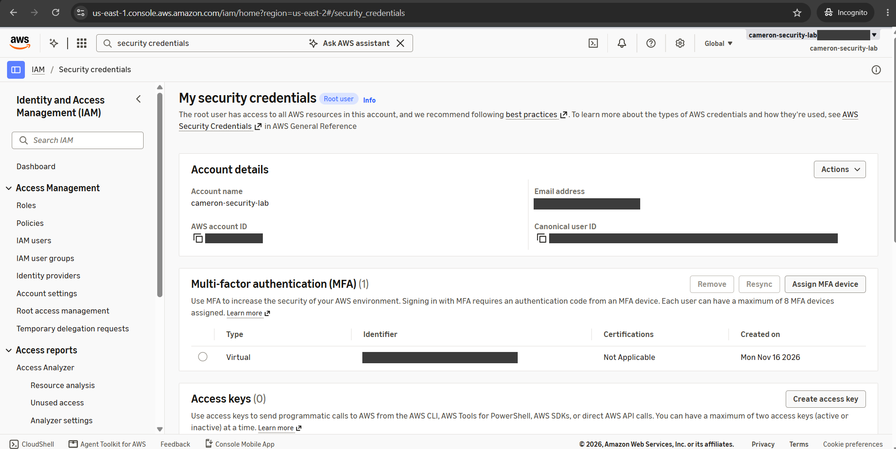

**Budget alert is set.**

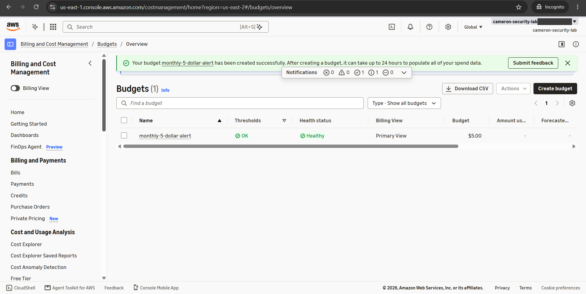

**The admins group has the AdministratorAccess policy.**

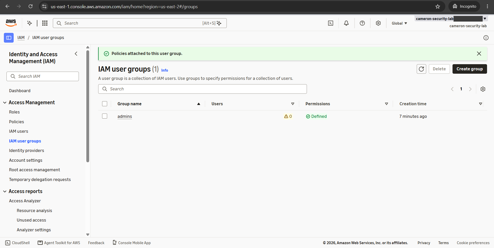

**cameron-admin exists and is in the group.**

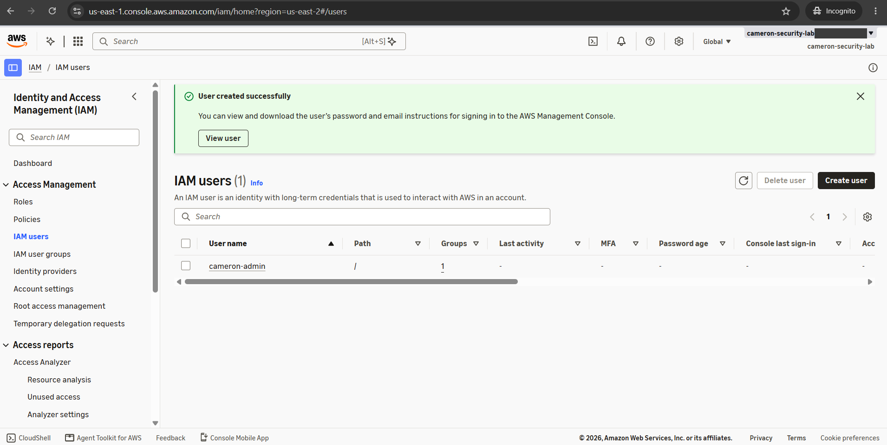

**cameron-admin has MFA turned on.**

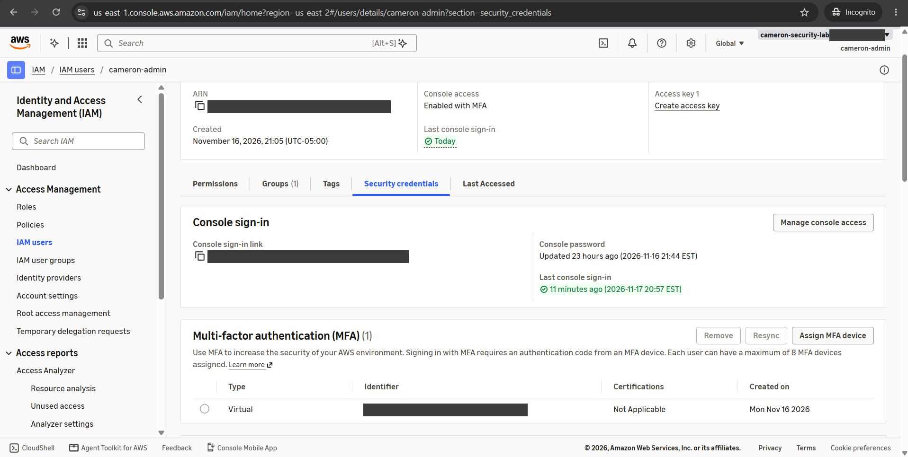

**The S3 bucket has default encryption (SSE-S3).**

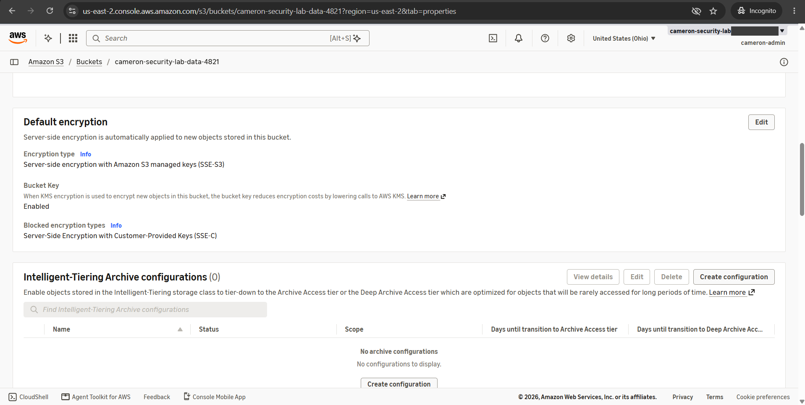

**Versioning is enabled.**

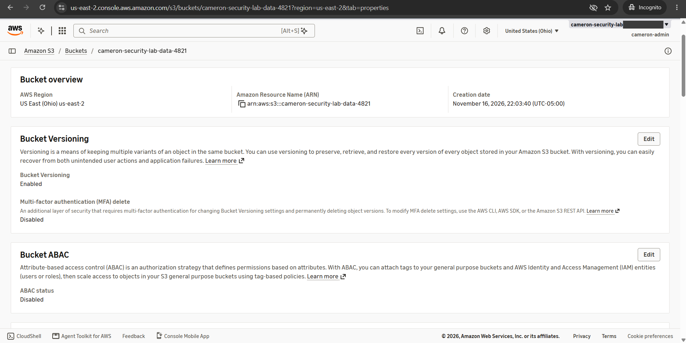

**Block All Public Access is on.**

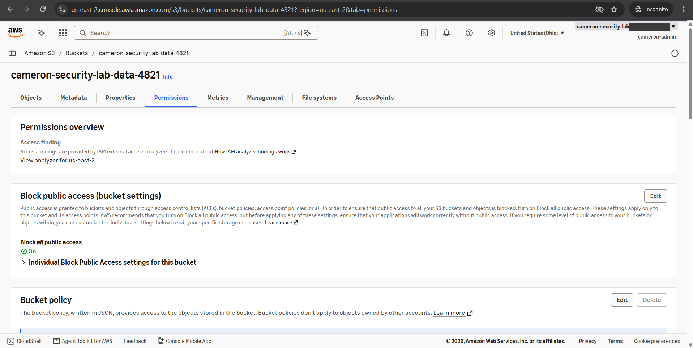

**The CloudTrail trail is multi region with log file validation enabled.**

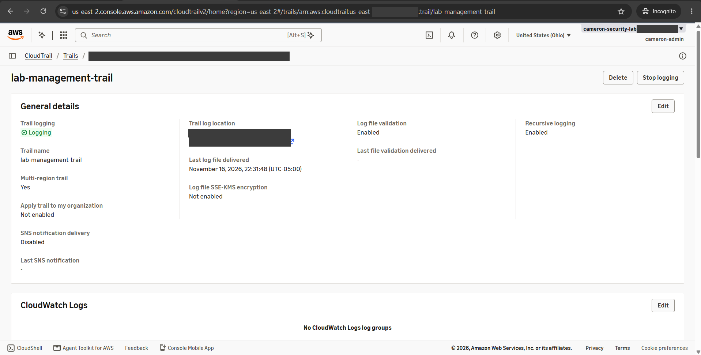

**CloudTrail caught my own activity.** Event history shows the CreateBucket calls from cameron-admin, which confirms the trail is logging what I actually do.

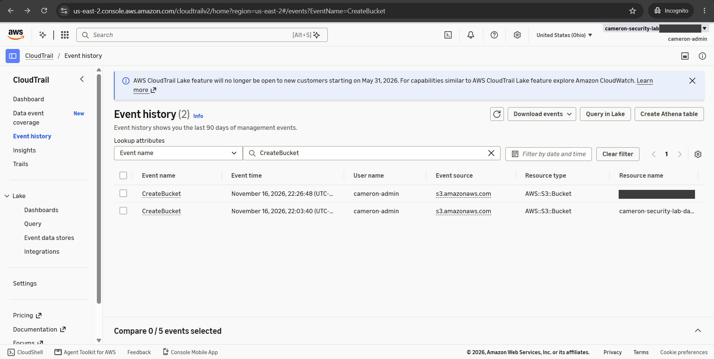

**GuardDuty produces findings.** These are sample findings that GuardDuty generates for you, so they're fake, but they show what a real alert looks like, including severity, type, and the affected resource.

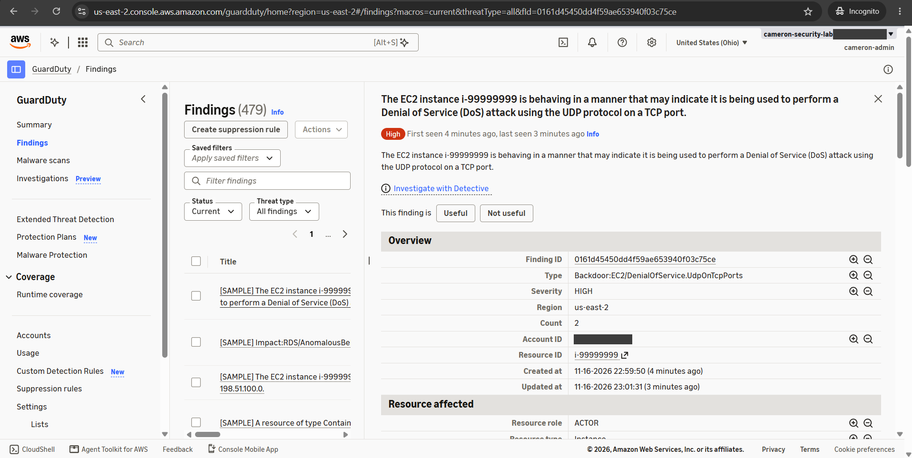

## Problems I ran into and how I fixed them

* **Wrong kind of account at first.** AWS now has a newer "project based" sign up that doesn't give you a root user or IAM users in the console. That doesn't work for this project, so I made a second account using the "Sign up for AWS (advanced)" option, which is the classic account with a real root user.
* **I leaked a password in a screenshot.** I had "Show password" checked while taking one. I treated that password as compromised, changed it to a new long unique one, and now I uncheck that box before any screenshot. All the screenshots in this repo have the account ID and email blacked out.
* **The admins group had no permissions.** After I made it, the group showed "Not defined" under Permissions. I had to attach AdministratorAccess from the group's Permissions tab. Making a group doesn't give it any permissions by itself.
* **Sign in as cameron-admin failed.** I kept getting "Authentication failed," so I reset the console password from the root account. I also had to sign out of my other AWS account first, because the browser was still signed in to it.
* **CloudTrail log file validation was off.** It showed Disabled right after I created the trail even though I thought I had turned it on. I edited the trail and enabled it, and I check it now after creating a trail.
* **GuardDuty sent me to an upgrade page.** The Free plan blocked it with a "Complete your account setup" screen. I upgraded to the Paid plan, which still uses any leftover credits first.
* **I enabled GuardDuty in the wrong region.** It turned on in N. Virginia instead of Ohio. GuardDuty is per region, so I enabled it in Ohio and disabled it in Virginia.

## What I learned

* Most of AWS security configuration details that you have to actually go check, because defaults aren't always safe and sometimes a setting doesn't save the way you expect
* Regions matter. Services like GuardDuty and CloudTrail trails behave differently per region, so it's easy to turn something on in the wrong place
* AdministratorAccess is too broad for real use. I used it to keep this lab simple, but in a real environment I'd write least privilege policies for each job
* CloudTrail only shows you something if you actually look at it. Having logs doesn't help if nobody reads them, which is why detection tools like GuardDuty are useful on top
* Writing down my mistakes made the whole thing click more than just following the steps

## Limitations

* The admin user has full AdministratorAccess, so this isn't true least privilege
* CloudTrail is only logging management events, not data events like S3 object reads
* GuardDuty findings here are sample data, not real threats
* I only used one account, so there's no AWS Organizations setup or separate accounts for logging

## Cost and cleanup

This lab costs very little. The first CloudTrail trail for management events is free, S3 storage here is tiny, and GuardDuty has a 30 day free trial. The $5 budget alert is there in case something unexpected gets turned on. Keep in mind that budgets only warn you, they don't cap spending.

The one thing that would start costing money after the trial is GuardDuty, so that's the first thing I shut off when I'm done with the lab.

## What's next

I'm planning to use this account for my AWS Certified Cloud Practitioner prep and to add more to it later, like Config rules, least privilege IAM policies, and alerts on CloudTrail events.
